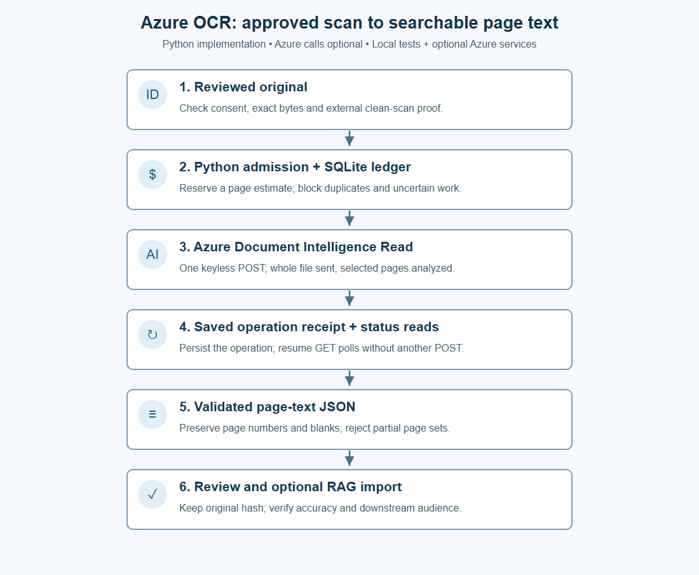

# Azure Document OCR with Python

[](docs/architecture.svg)

[View SVG](docs/architecture.svg) · [Download PNG](docs/architecture.png)

**Read approved scans into page-numbered text without losing the original or paying twice for an uncertain request.**

[Business problem](#the-business-problem) · [Solution](#the-solution) · [What was built](#what-was-built) · [Build your own](#build-one-of-your-own) · [Proof](#proof-it-works)

## The business problem

A scanned handbook can be readable to a person but invisible to document search.
Staff then waste time opening pages or copying text, while automatically sending
every uploaded document to AI creates unnecessary privacy and cost exposure.
This project prepares approved scans for search while preserving the original
and making processing decisions, page coverage and uncertain submissions visible.

## The solution

Use Python to coordinate Azure AI Document Intelligence `prebuilt-read`.
Check permission and exact source bytes, reserve a processing estimate, submit
once, save the operation address, poll that operation, and publish validated
page-numbered text. OCR recognizes text; it does not generate a chatbot answer,
perform malware scanning, redact unselected pages or produce a searchable PDF.

## What was built

- A runnable offline OCR fixture with a populated page and a blank page.
- A Python Azure REST adapter using Entra credentials, selected pages and a
  persisted operation receipt; redirects and automatic paid retries are blocked.
- File signature/10 MiB limits, up to 50 selected pages within pages 1–500,
  page-set validation, a one-million-character result ceiling and a usage ledger.
- Resume support for the same recorded operation, plus Terraform preparation,
  a diagram, source references and tests for denial, duplicates and uncertainty.

## Build one of your own

### Step 1 — Create your project folder

Create an empty folder named `azure-document-ocr-python` and add `ocr_project`,
`examples`, `tests` and `docs` subfolders. Use the included Python files as small
implementation references while building the components below; no repository
clone is required.

```powershell
mkdir azure-document-ocr-python
cd azure-document-ocr-python
python -m venv .venv
```

Commands below run from that folder after placing the accompanying files in
their indicated paths. On Windows use `.venv\Scripts\python`; on Linux/macOS
substitute `.venv/bin/python`.

### Step 2 — Separate local checks from Azure execution

Implement file/page checks and the atomic usage ledger before adding a service
call. Keep the optional Azure dependency separate so a learner can run the
fictional demo and tests without credentials or cloud charges.

```powershell
.venv\Scripts\python -m unittest discover -s tests -v
.venv\Scripts\python -m ocr_project demo --output work/ocr-pages.json
```

### Step 3 — Preserve page identity and empty pages

Parse the fixture in `examples/provider-response.json` into `{page,text}`
records and reject missing, repeated or unexpected page numbers. Keep a truly
blank page as empty text, and review recognition accuracy rather than assuming
every successful provider response is correct.

The demo writes `method: fictional-offline-fixture` and no source hash. It is
intentionally unsuitable as genuine OCR evidence for the RAG importer.

### Step 4 — Prepare the Azure service and identity

In Azure, prepare a Document Intelligence account and give a dedicated caller
the account-scoped `Cognitive Services User` role. Use the optional Terraform
example with an existing private subnet/DNS zone, then verify private resolution
and endpoint reachability from the intended caller before enabling live mode.

```powershell
.venv\Scripts\python -m pip install -r requirements-azure.txt
az login
# Inspect infra/README.md and your plan before creating any resource.
```

### Step 5 — Bind consent to the exact approved file

Review the whole file, verify its genuine clean-scan result outside this local
sample, and record its SHA-256 plus the pages to process. The API sends the
**entire file** even when only selected pages are analyzed, so approve that
transfer explicitly and use a reviewed current per-page cost estimate.

```powershell
(Get-FileHash .\approved-scan.pdf -Algorithm SHA256).Hash.ToLower()
```

### Step 6 — Add one deliberate Azure submission

Set the endpoint and estimate in your own environment, then call `analyze`
with a fresh UUID only for a genuinely new request. Keep live execution Off
until the source, access, network and costs are ready; the following is an
operator-run example and was not executed against Azure for this project.

```powershell
$env:ALLOW_AZURE_CALLS = 'yes'
$env:AZURE_DOCUMENT_ENDPOINT = 'https://YOUR-RESOURCE.cognitiveservices.azure.com'
$env:OCR_ESTIMATE_MICRO_PER_PAGE = '1500' # Illustrative, not a current quote.
.venv\Scripts\python -m ocr_project analyze .\approved-scan.pdf --pages 1,2 --actor local-operator --request-id YOUR-UUID --reviewed-sha256 YOUR-SHA256 --allow-ocr
```

### Step 7 — Save the receipt before waiting for completion

Persist the validated `Operation-Location` before polling and accept only the
configured Azure origin, model-result path and API version. If waiting fails
after that receipt exists, resume its GET status checks without submitting
another paid POST.

```powershell
.venv\Scripts\python -m ocr_project resume --request-id SAME-UUID --output work/ocr-pages.json
```

If the result is already saved as completed, `resume` can restore its JSON
output with live calls Off and without Azure credentials. Pending/unknown
operations still require the original authorized endpoint and live-read setting.

Each status request has a 25-second transport timeout and at most 45 polls per
invocation. This is not a 45-second end-to-end deadline, and credential retrieval
has its own SDK timing; use a proper wall-clock deadline in a hosted worker.

### Step 8 — Review the output and hand it to search

Inspect the page-text JSON against the original scan, especially names, dates,
tables and faint text. Keep its `source_sha256` and expected Azure method label
when passing it to the companion RAG project's explicit OCR importer, while
retaining the original PDF and controlling access to both.

## Proof it works

Run `python -m unittest discover -s tests -v` to exercise the offline contracts.
The tests demonstrate page mapping, empty-page preservation, permission/hash
denials, foreign-operation rejection, duplicate blocking, unknown holds and
GET-only recovery; they do not claim live Azure OCR or a malware-scanned upload.

The fictional provider response is a test input, not a screenshot of a real
employee report. See [validation](docs/validation.md) for the recorded local run.

## Azure references

- [Read model and input requirements](https://learn.microsoft.com/en-us/azure/ai-services/document-intelligence/prebuilt/read?view=doc-intel-4.0.0)
- [Analyze document REST contract](https://learn.microsoft.com/en-us/rest/api/aiservices/document-models/analyze-document?view=rest-aiservices-v4.0%20%282024-11-30%29)
- [Azure Identity for Python](https://learn.microsoft.com/en-us/python/api/overview/azure/identity-readme)

The adapter uses the documented `2024-11-30` API and `base64Source` request;
it supports only PDF/JPG/PNG even if the service supports more formats.

## Save results without overwriting originals

The CLI publishes a complete JSON file without overwriting an existing source,
ledger or different result. Saving the same bytes to the same path is harmless;
for a different result choose a new filename. If OCR completed but export failed,
use `resume --output NEW-FILENAME.json` with the same request ID, never another
paid submission. Safe publication requires a filesystem supporting same-directory
hard links; unsupported filesystems fail closed instead of using an unsafe overwrite.
An interrupted process can leave a private `.ocr-result-*` temporary file; check
and remove only that abandoned local output after confirming no exporter runs.
This file-write mechanism is not a backup or a complete power-loss guarantee.

## Input errors and identity keys

Page selections are validated before a paid reservation: use a list of distinct
integer page numbers, never strings, booleans or nested values. A missing or
nontext provider operation address leaves the existing request held for
investigation rather than inviting another submission.

## Tools and utilities

Python 3.11+, SQLite, `unittest`, Azure CLI and the optional `azure-identity`
library provide the local implementation, durable records, tests and keyless
Azure authentication. GitHub Actions includes a manual offline-test workflow. Local checks run
without cloud credentials; publishing the repository does not activate Azure services.

## Runtime and access boundaries

The Python example runs as a **trusted local operator CLI** with SQLite, not as a
hosted multi-user service. CLI role/actor arguments, local files and SQLite are
operator-controlled; they must never be accepted as proof of identity from a
web request. There is no login endpoint, Entra JWT validation, malware scanner,
private Blob reader, production queue lease, encryption wrapper, UI or managed
service deployment wired into this sample. Azure adapters are prepared and
mock-tested, not exercised against live services in this review.

## Security and privacy

Use fictional material first. A matching SHA-256 binds a review to exact bytes;
it is not a malware verdict or evidence that the document is safe. A production
intake must verify a genuine Defender clean result tied to the exact Blob version,
protect the original and obtain processing/audience permission before this code
is called. The local JSON manifests/results and SQLite files may contain private
text; keep them on access-controlled encrypted storage and outside Git.

Azure authentication uses `DefaultAzureCredential` only when live mode is
explicitly selected. Use a dedicated managed identity in a hosted deployment,
disable local-key authentication, scope the service data role to its account,
and verify DNS/private networking before sending files or passages. A private
endpoint alone is insufficient without working DNS and a private caller path.

Routine ledger audit stores request IDs, times and fixed outcomes, not raw
questions/answers or token values. A content fingerprint is still metadata that
needs access protection. Neither `store=false`, Azure hosting nor encryption
alone establishes HIPAA/SOC 2 compliance or guarantees zero provider retention;
review applicable service terms, geography and organizational obligations.

## Costs and safe restart

Local tests and fictional demos make no cloud requests. The optional Azure path
can incur processing, private-endpoint, DNS, storage and log charges; no resource
is created by running the Python demo. The Terraform example is preparation,
not an instruction to apply it to an existing production environment.

The default local processing allowance is $3 per UTC month per ledger, expressed
as 3,000,000 microdollars. This admission limit is separate from infrastructure costs and is not an Azure
invoice cutoff. Use a reviewed conservative
per-operation estimate; completed work retains that estimate rather than
claiming actual token/page reconciliation. Underestimates, separate ledgers,
shared resources, reporting lag and infrastructure charges can exceed that plan.

Admission uses an atomic SQLite transaction: one reserved/unknown paid request
at a time **per ledger** and 20 reservations per actor per UTC day. Not-sent work frees its
processing estimate but still counts toward the daily limit. A timeout after
submission is unknown and continues to block work, including across month
boundaries. An unknown record cannot be changed to `not_sent`, saved operation receipts
cannot be replaced, and completed results are immutable. Reconcile provider
status and billing before an operator repairs an unknown hold; there is deliberately no automatic clear/retry command.

Never delete the ledger simply to bypass a hold. Back up its exact state along
with originals, policies and index versions; a successful database restore
alone does not prove application failover or absence of duplicate paid work.

The two independent projects use separate ledgers unless deliberately
configured otherwise; their allowances and concurrency slots are not a single
shared Azure budget. A fresh UUID after a completed request represents new
paid work, so duplicate-ID protection is not content-based deduplication.

## Troubleshooting lessons

- **Service or private path unavailable:** inspect resource state, endpoint/DNS,
  credentials and scoped access before changing the file or paying for a retry.
- **403 despite successful sign-in:** a token proves identity, not the required
  service permission; verify the correct principal, tenant, audience and role scope.
- **Result unknown after a timeout:** preserve the request ID and ledger; do not
  create a fresh paid operation merely because the browser/CLI stopped waiting.
- **File changed:** original bytes, review hash and derived text must agree;
  update the review and index deliberately instead of relabeling old evidence.

## Scaling and tradeoffs

SQLite and local files keep this exercise easy to inspect but are not a
distributed coordination/security boundary. Measure queue wait, scan delay,
page/text size, token usage, denial rates and paid-operation uncertainty before
moving to Azure SQL jobs with leases and atomic publication. Add bounded worker
concurrency only after shared admission, provider quota and idempotency are
proven across instances; otherwise retries can multiply spend and stale results.

Keep ingestion, retrieval and generation independently switchable. A production
rollout also needs genuine scan integration, verified current staff/tenant
claims, protected Blob versions, content-free operational logs, CI dependency
and secret scans, restore rehearsal and measured relevance/accuracy checks.
Private paths and new search tiers introduce standing costs even with no users.

## OCR-to-RAG handoff

The CLI exports schema-1 JSON as UTF-8 with page numbers, source SHA-256 and the
expected method label. This avoids unnecessary Unicode escaping that could
inflate a valid result beyond the RAG CLI's 8 MiB JSON limit. Text must be valid
Unicode and the RAG source must separately approve OCR, audience and AI choices;
the method label is not a signed provider proof or automatic permission grant.

The standalone `demo` output stays marked fictional and has no source hash, so
the RAG importer intentionally rejects it as real OCR evidence. The shared bundle
tests exercise the real Python adapter/export/import path with a **mocked** OCR
response; they make no provider or model request and establish no recognition quality.

## Related projects

- [Role-aware RAG with Python](https://github.com/truthofsource/azure-role-aware-rag-python)
- [Email document ingestion with Python](https://github.com/truthofsource/azure-document-ingestion-python)
- [Employee badge generation with Python](https://github.com/truthofsource/employee-badge-generation-python)

Publishing this code does not start a service, approve a document or enable paid processing.
